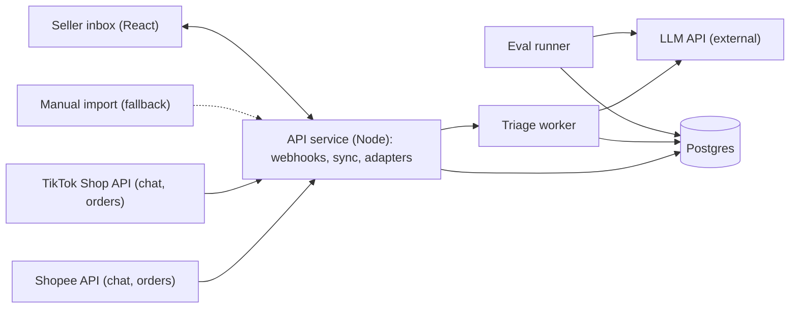
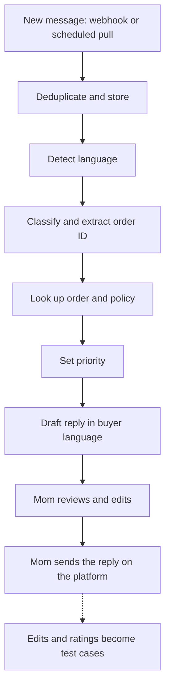

# 02 Architecture

## Overview

## Components

| Component | Responsibility | Notes |
|---|---|---|
| Seller inbox | One inbox for both platforms: tickets sorted by priority, draft editing, approval, manual import | React |
| API service | Tickets, orders, policies, login; channel adapters; webhook receiver; scheduled catch-up sync | Node; controller, service, repository layers |
| Channel adapters | One adapter per source (Shopee, TikTok, manual import) that maps the source format to one common message format | Swappable; the manual adapter keeps the system working without API approval |
| Triage worker | Detect language, classify, extract order ID, look up order and policy, write the draft | Calls the LLM |
| Postgres | Messages, conversations, tickets, orders, policies, drafts, reviews, tokens, sync state, evaluation data, audit log | See 03 |
| LLM API | External model | Model choice: see 05 and 06 |
| Eval runner | Scores the triage worker against a labeled set and checks ingestion reliability | Can run in CI |

## Message flow

In Phase C, step I becomes "send through the API after Mom approves this single message".

## Design decisions

| Decision | Choice | Reason | Status |
|---|---|---|---|
| Sending | Drafts only; Mom sends | A wrong reply costs money and reputation; sending may need extra permissions and platform approval | [Proposed] |
| Intake | Webhook plus scheduled catch-up pull | A webhook that returns success does not prove messages arrive; the platform recommends querying the API to recover and validate state | [Proposed] |
| Duplicates | Unique key on shop and channel message ID | Webhooks can repeat | [Proposed] |
| Adapters | One interface, several implementations | Lets manual import and the APIs share the same triage code | [Proposed] |
| Queue | A job table in Postgres, a real queue later | One fewer component to run | [Proposed] |
| Prices and policies | Read from the database, never recalled by the model | Money answers must be checkable | [Proposed] |
| Evaluation | Separate component, runs in CI | A number for every prompt or model change | [Proposed] |
| Non-text messages | Marked "needs human" in the first versions | Some message types are not returned as text by the API | [Proposed] [Unverified] |

## Not drawn

- CI/CD pipeline
- Logs, error alerts, per-call cost tracking
- Login and secret management (app keys in environment variables, never in the repository)
- Ingestion health monitoring (time of last message received, authorization expiry, failed webhooks)
- Prompt injection and malformed input tests

## Deployment order

Docker container, then a container registry, then a simple always-on managed service, then CI/CD, then understand Kubernetes as a concept. Webhooks need an always-on public HTTPS address, so free tiers that sleep when idle do not work for real intake. Pick the cloud after reading 10 job descriptions.
